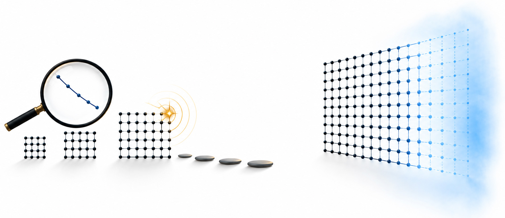

# What a Quantum Milestone Warrants: Computational Supplement

<p align="left">
  
</p>

Computational supplement to:

**Peter Kahl, ‘What a Quantum Milestone Warrants: Error Correction, Evidence and Scaling Decisions’ (2026). Lex et Ratio Working Paper LXR-2026-QUANT-WQMW-WP. DOI to be assigned.**

The paper asks what a quantum error-correction (QEC) milestone warrants. A company has shown a below-threshold logical memory at small code distances. Before it commits to a much larger memory, which further evidence, if any, is worth buying? Section 6 of the paper answers that question in a deliberately simple decision model. This repository contains the scripts behind Section 6, the complete output of each reference run, and the script that draws Figure 6.1.

**Toy model.** The scripts do not model Google's Willow processor or any real device. They use magnitudes like those Google reports (Google Quantum AI and Collaborators, ‘Quantum error correction below the surface code threshold’, *Nature* 638 (2025) 920–926, [doi:10.1038/s41586-024-08449-y](https://doi.org/10.1038/s41586-024-08449-y)) so that orders of magnitude are realistic. Every number the scripts print follows from stated assumptions; none is an estimate of a real error budget.

## Contents and correspondence with the paper

| Script | Paper | What it shows |
|---|---|---|
| `lambda_blindness_check.py` | §6.3, §6.8 | The headline metric (the suppression factor Λ fitted at distances 3, 5 and 7) cannot see rare correlated events that decide a scaling decision; what a zero-failure demonstration run can show |
| `decision_model.py` | §§6.1–6.7 | The value of each candidate experiment to the decision to scale, against the value of perfect and of partial perfect information, in twelve cases |
| `robustness_checks.py` | §6.6 | Which parameter the decision hinges on; a possible change in scaling beyond the largest distance tested; misattribution of ordinary failures to events |
| `make_figure_6_1.py` | Figure 6.1 | Draws the figure from the output of `decision_model.py` |

Reference outputs are in `output/`. The version history is in the [changelog](CHANGELOG.md).

## The scripts

### `lambda_blindness_check.py`

Compares two noise hypotheses: pure suppression, and suppression plus a rare-event floor B(d) = B₇ · (d/7)^κ. It asks how far the floor moves the fitted Λ, how long more of the headline measurement would take to tell the hypotheses apart, and how long a direct count of rare events would take.

In the reference run, a floor of 10⁻¹⁰ per cycle (the order of the floor Google reports in its long repetition-code runs) moves the fitted Λ by about 3 × 10⁻⁶ of its reported standard error. The floor becomes visible in Λ only at about 3.5 × 10⁻⁵. Floors that change the scaling decision yet leave Λ within one standard error span 5.2 decades for a target of 10⁻⁹ per cycle, and 8.2 decades for 10⁻¹².

Table 6 treats direct demonstration. Assuming independent cycles, a zero-failure run supporting 10⁻⁹ per cycle at 95% confidence needs about 3 × 10⁹ cycles, about 55 minutes at 1.1 µs per cycle. A device that just meets the target passes only about 10% of the time; to pass with 90% probability it must be about 28 times better than the target.

### `decision_model.py`

**Hypotheses.** Rare correlated events occur under every hypothesis; hypotheses differ in what they do. A hypothesis θ = (r, μ, κ) gives the logical error per cycle at distance d as

p(d) = P₇ · Λ^((7 − d)/2) + r · q(d), with q(d) = min{1, μ · (d/7)^κ},

where r is the rate of rare events per cycle (10⁻¹¹, 10⁻¹⁰, 10⁻⁹), μ the probability that one event causes a logical failure in the distance-7 memory (0.01, 0.1, 1), and κ how that probability changes with distance (−2, 0, +2). The prior is uniform over the 27 hypotheses unless a case says otherwise.

**Decision.** Target 10⁻⁹ per cycle, which pure suppression meets at distance 45. Build the standard design (cost 40), build a design with mitigation against rare events (cost 60), or do not commit (included for completeness; never chosen). A design that meets the target pays 100. Units are arbitrary.

**Experiments**, compared at equal machine time:

| Option | What it observes | Informs |
|---|---|---|
| O2 | More logical-failure counts at distances 3, 5 and 7 (the headline metric), in its best case | — |
| O3 | Count detectable rare events in a long run | r |
| O4a | Tag events at distance 7: count them and record which ones cause a logical failure | r, μ |
| O4b | O4a plus a per-event 'footprint' signal; valid only with a validated mechanism model (stipulated, for comparison; not used in the paper) | r, μ, κ |
| O5 | Tag events at distances 7 and 15 at once, on one device of about 550 qubits | r, μ, κ |

**Method.** Each experiment is valued by the expected value of sample information, computed by preposterior Monte Carlo (1,500 simulated datasets per hypothesis; fixed seed). For each simulated dataset the posterior over the grid is updated, the best action chosen, and that action scored under the hypothesis that generated the data, so misleading datasets count against the experiment. Partial values of perfect information are computed exactly over the grid. Net value subtracts machine time at 0.02 units per hour and any set-up cost.

**Main results** (reference run, 100 machine-hours; shares of the value of perfect information):

| Case | Perfect information | Headline metric | Count events | Tag at d = 7 | Tag at d = 7 and 15 |
|---|---|---|---|---|---|
| Reference | 11.9 | 0% | 69% | 69% | 100% |
| Far from the boundary (mitigation costs 85) | 8.1 | 0% | 0% | 30% | 99% |
| Mitigation removes only half the effect | 7.4 | 0% | 0% | 30% | 99% |
| Narrower κ range (±1) | 8.9 | 0% | 50% | 75% | 100% |
| Prior weighted to κ = +2 | 15.6 | 0% | 86% | 86% | 100% |
| Mitigation cheaper (50) | 8.5 | 0% | 78% | 78% | 100% |
| Mitigation dearer (70) | 10.4 | 0% | 46% | 46% | 99% |

The output also covers set-up costs for O5, partial mitigation removing 90% of the effect, a wider κ range, half detection efficiency, the hypotheses under which the standard design fails, Monte Carlo stability across seeds (variation 0.01 or less), and how small the rare-event contribution is, relative to ordinary errors, at intermediate distances.

### `robustness_checks.py`

- **Table P.** In the reference case, knowing r alone is worth 8.15 of the 11.85 available, μ alone 0.74 and κ alone 4.44. Far from the decision boundary, no single parameter is worth anything alone, yet r and μ together are worth 2.41 and all three 8.15: information is not additive.
- **Table S.** The single exponent κ is split into κ₁ (distance 7 to 15, which a two-distance experiment can see) and κ₂ (15 to 45, which no experiment at distance 15 or below can see): 81 hypotheses. Tagging at distances 7 and 15 then captures 80% of the value in the reference case and 54% far from the boundary; 20% and 46% respectively are unreachable by any experiment at distance 15 or below.
- **Table M.** Ordinary failures inside an event's attribution window are mistaken for event-caused ones (1.4% of windows at distance 7 for a 10-cycle window, 13% for a 100-cycle window). If the analyst models this, tagging at two distances is worth 11.68–11.80, against 11.81 with no misattribution. If the analyst ignores a 13% coincidence rate, it falls to 8.89, little more than counting events (8.15).

### `make_figure_6_1.py`

Draws Figure 6.1, the value of each experiment against machine time in the reference case and far from the decision boundary, from `output/decision_model_results.json`. Each line has its own colour, marker and direct label.

## Running the scripts

```bash
python3 -m venv .venv
source .venv/bin/activate          # Windows: .venv\Scripts\activate
python -m pip install -r requirements.txt

python lambda_blindness_check.py | tee output/lambda_blindness_check_output.txt   # seconds
python decision_model.py         | tee output/decision_model_output.txt           # about 90 s
python robustness_checks.py      | tee output/robustness_checks_output.txt        # about 15 s
python make_figure_6_1.py                                                         # needs decision_model output
```

Each script also writes its results as JSON to `output/`; give a different path as the first argument if preferred. Run the scripts from the repository root: `robustness_checks.py` imports `decision_model.py`.

The Monte Carlo seed is fixed (20261016). The reference outputs were produced with Python 3.13.16, NumPy 2.5.3, SciPy 1.18.1 and matplotlib 3.11.2. Other versions should reproduce the results to within Monte Carlo variation; exact textual reproduction may need those versions.

## Limits

The model is a toy, and its limits are stated in §6.9 of the paper:

- The hypothesis grid is coarse and the results depend on it. In the reference case the decision turns on an event rate (10⁻⁹ per cycle) about three times the rate Google reports for correlated events in its repetition codes.
- The scaling shapes are stylised, not derived from any mechanism. The links from events to logical failures, and from small-memory observations to a distance-45 memory, are assumed.
- Tagging is idealised apart from the coincidences modelled in Table M.
- No clustering in time, no decoder and no circuit-level noise; each event causes at most one failure; Λ is assumed constant across a device of about 4,000 qubits.
- The numbers are magnitudes, not estimates.

## Citation

Please cite the paper for the argument and this repository for the code. Citation metadata is in [`CITATION.cff`](CITATION.cff); the software DOI will be assigned on deposit with Zenodo.

## Licence

MIT License. Copyright (c) 2026 Peter Kahl. See [`LICENSE`](LICENSE).

## Author

Peter Kahl, Independent researcher, Lex et Ratio · [lexetratio.com](https://www.lexetratio.com) · ORCID [0009-0003-1616-4843](https://orcid.org/0009-0003-1616-4843)
